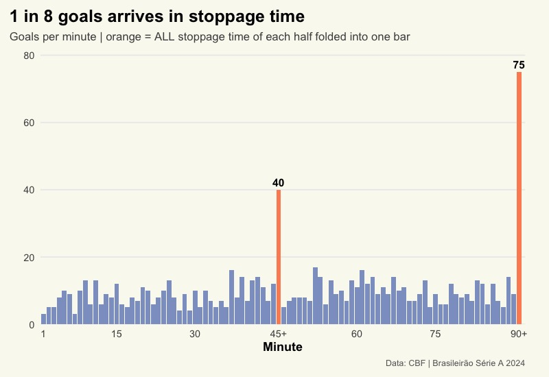
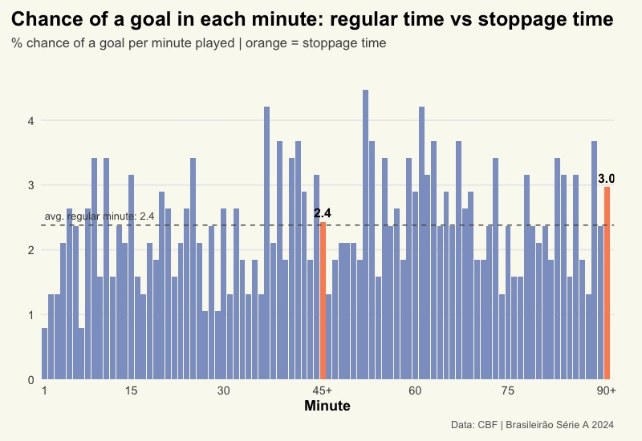
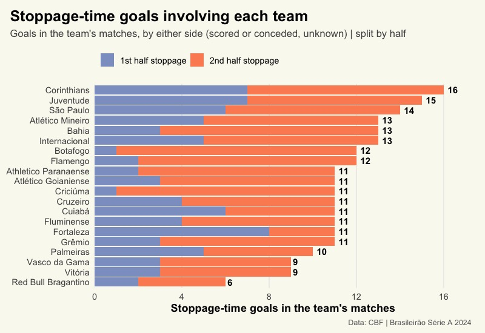
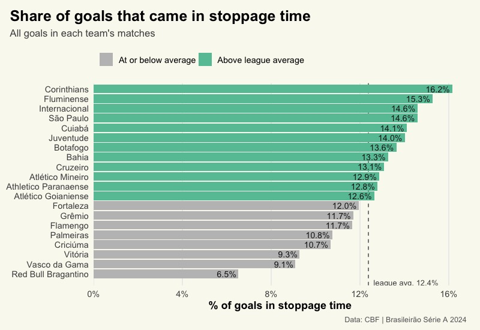

## The question

Stoppage time is where matches are often decided. Using every goal of
the 2024 Campeonato Brasileiro Série A, this article looks at:

-   How much of the league’s scoring comes after the 45’ and 90’ marks?
-   Which minutes of stoppage time are the most dangerous?
-   Which teams lived the most late drama?

**Data:** every goal of the season, with match, half and minute (929
goals, 380 matches). Compiled from the official CBF match reports
(súmulas).<br> **Limitation:** the dataset does not say *which team*
scored. A stoppage-time goal therefore counts for **both** teams in the
match, so this is about late drama, not about who benefited.

## Key takeaways

-   **115 of 929 goals (12.4%) came in stoppage time**, roughly 1 in
    every 8.
-   **The second half dominates:** 75 goals in 90+ against 40 in 45+.
-   **26% of all matches had at least one stoppage-time goal.**
-   **Corinthians, Juventude and São Paulo** were involved in the most
    stoppage-time goals; Red Bull Bragantino in the fewest.

## 1. When are goals scored?

**What to notice:** the two orange bars tower over everything else (40
goals in 45+ and 75 in 90+, against about 9 goals in an average regular
minute). But each orange bar folds *several* minutes into one, this
might give the impression that stoppage time has more goals. Let’s
normalise the counts by minutes played.

``` r
ggplot(minute_df, aes(x = Minute_Bucket, y = n, fill = Is_Stoppage)) +
  geom_col() +
  geom_text(
    data = filter(minute_df, Is_Stoppage),
    aes(label = n), vjust = -0.5, fontface = "bold", size = 4
  ) +
  scale_fill_manual(values = c("FALSE" = COL_1ST, "TRUE" = COL_2ND)) +
  scale_x_discrete(
    breaks = c("1", "15", "30", "45+", "60", "75", "90+"),
    expand = expansion(add = c(0.6, 1.2))        # extra room after the last bar
  ) +
  scale_y_continuous(expand = expansion(mult = c(0, 0.08))) +
  labs(
    title    = sprintf("1 in %d goals arrives in stoppage time", one_in),
    subtitle = "Goals per minute | orange = ALL stoppage time of each half folded into one bar",
    x = "Minute", y = "", caption = SOURCE_CAPTION
  ) +
  theme_article() +
  theme(
    legend.position = "none",
    panel.grid.major.x = element_blank(),
    plot.margin = margin(t = 10, r = 25, b = 10, l = 10)   # right padding (points)
  )
```



## 2. Normalized view

**What to notice:** the stoppage-time effect is suggestive, not proven.
The 95% range for stoppage time (2.25–3.26%) overlaps with the regular
range (2.22–2.54%). The 90+ bar is the strongest signal (2.30–3.64%),
but with one season of data you can’t rule out chance. The 45+ bar alone
(1.68–3.19%) tells you nothing on its own.

``` r
# ---- 1. Exposure: stoppage minutes actually played (CBF match reports) ----
extra_time_df <- read.csv(
  "data/serie_a_final_scores.csv"
) %>%
  filter(year == 2024) %>%
  select(game_number, first_half_extra_time, second_half_extra_time) %>%
  mutate(across(everything(), as.integer))

extra_min_1st <- sum(extra_time_df$first_half_extra_time,  na.rm = TRUE)
extra_min_2nd <- sum(extra_time_df$second_half_extra_time, na.rm = TRUE)

# ---- 2. Normalise: goals per 100 match-minutes ----
# Regular minute: every match plays it     -> exposure = 380 minutes
# 45+ / 90+ bar : sum of stoppage minutes  -> exposure = total minutes played
rate_df <- minute_df %>%
  mutate(
    exposure = case_when(
      Minute_Bucket == "45+" ~ as.numeric(extra_min_1st),
      Minute_Bucket == "90+" ~ as.numeric(extra_min_2nd),
      TRUE                   ~ as.numeric(TOTAL_MATCHES)
    ),
    rate = n / exposure * 100
  )

# Reference: average regular-time minute, and numbers for the text
rate_regular <- sum(filter(rate_df, !Is_Stoppage)$n) / (90 * TOTAL_MATCHES) * 100
rate_1st     <- filter(rate_df, Minute_Bucket == "45+")$rate
rate_2nd     <- filter(rate_df, Minute_Bucket == "90+")$rate

# ---- 3. Chart (same layout as item 1) ----
ggplot(rate_df, aes(x = Minute_Bucket, y = rate, fill = Is_Stoppage)) +
  geom_col() +
  geom_hline(yintercept = rate_regular, linetype = "dashed", color = "grey35") +
  geom_text(
    data = filter(rate_df, Is_Stoppage),
    aes(label = sprintf("%.1f", rate)), vjust = -0.5, fontface = "bold", size = 4
  ) +
  annotate("text", x = "1", y = rate_regular, hjust = 0, vjust = -0.8, size = 3.3,
           color = "grey30",
           label = sprintf("avg. regular minute: %.1f", rate_regular)) +
  scale_fill_manual(values = c("FALSE" = COL_1ST, "TRUE" = COL_2ND)) +
  scale_x_discrete(
    breaks = c("1", "15", "30", "45+", "60", "75", "90+"),
    expand = expansion(add = c(0.6, 1.2))        # extra room after the last bar
  ) +
  scale_y_continuous(expand = expansion(mult = c(0, 0.1))) +
  labs(
    title    = "Chance of a goal in each minute: regular time vs stoppage time",
    subtitle = "% chance of a goal per minute played | orange = stoppage time",
    x = "Minute", y = "",
    caption = SOURCE_CAPTION
  ) +
  theme_article() +
  theme(
    legend.position = "none",
    panel.grid.major.x = element_blank(),
    plot.margin = margin(t = 10, r = 25, b = 10, l = 10)   # right padding (points)
  )
```



``` r
z <- qnorm(0.975)   # 1.96 for a 95% range

# ---- 1. Goals and minutes played for each group ----
groups <- bind_rows(
  rate_df %>% filter(!Is_Stoppage)           %>% summarise(k = sum(n), minutes = sum(exposure)) %>% mutate(group = "Regular time"),
  rate_df %>% filter(Minute_Bucket == "45+") %>% summarise(k = sum(n), minutes = sum(exposure)) %>% mutate(group = "45+"),
  rate_df %>% filter(Minute_Bucket == "90+") %>% summarise(k = sum(n), minutes = sum(exposure)) %>% mutate(group = "90+"),
  rate_df %>% filter(Is_Stoppage)            %>% summarise(k = sum(n), minutes = sum(exposure)) %>% mutate(group = "Both stoppage")
)

# ---- 2. Rate, standard error and 95% range (Poisson approximation) ----
ci_df <- groups %>%
  mutate(
    rate  = k / minutes * 100,            # goals per 100 match-minutes (= % chance per minute)
    se    = sqrt(k) / minutes * 100,
    lower = rate - z * se,
    upper = rate + z * se
  )

# ---- 3. Compare each stoppage group with regular time ----
reg <- filter(ci_df, group == "Regular time")

ci_df <- ci_df %>%
  mutate(
    diff    = rate - reg$rate,
    z_stat  = diff / sqrt(se^2 + reg$se^2),
    p_value = 2 * (1 - pnorm(abs(z_stat)))
  ) %>%
  mutate(across(c(diff, z_stat, p_value), ~ ifelse(group == "Regular time", NA, .x)))

ci_df %>% mutate(across(where(is.numeric), ~ round(.x, 3)))
```

    ## # A tibble: 4 × 10
    ##       k minutes group          rate    se lower upper   diff z_stat p_value
    ##   <dbl>   <dbl> <chr>         <dbl> <dbl> <dbl> <dbl>  <dbl>  <dbl>   <dbl>
    ## 1   814   34200 Regular time   2.38 0.083  2.22  2.54 NA     NA      NA    
    ## 2    40    1645 45+            2.43 0.384  1.68  3.18  0.051  0.131   0.896
    ## 3    75    2525 90+            2.97 0.343  2.30  3.64  0.59   1.67    0.095
    ## 4   115    4170 Both stoppage  2.76 0.257  2.25  3.26  0.378  1.40    0.162

## 3. Which teams were involved in the most stoppage-time goals?

Each stoppage-time goal is counted for **both** teams in the match. We
don’t know who scored, so a team’s number mixes goals it scored and
goals it conceded.

**What to notice:** Corinthians (16), Juventude (15) and São Paulo (14)
were involved in the most stoppage-time goals; Red Bull Bragantino in
the fewest (6). The split by half is revealing: 8 of the 11
stoppage-time goals in Fortaleza matches came in first-half stoppage,
while in Botafogo matches almost all of them (11 of 12) came in the
second half.

``` r
team_order <- team_df %>% arrange(stoppage_goals, desc(team)) %>% pull(team)

team_plot_df <- team_df %>%
  mutate(team = factor(team, levels = team_order)) %>%
  pivot_longer(c(stoppage_1st_half, stoppage_2nd_half),
               names_to = "half", values_to = "goals") %>%
  mutate(half = factor(half,
                       levels = c("stoppage_1st_half", "stoppage_2nd_half"),
                       labels = c("1st half stoppage", "2nd half stoppage")))

team_totals <- team_df %>% mutate(team = factor(team, levels = team_order))

ggplot(team_plot_df, aes(x = goals, y = team, fill = half)) +
  # reverse = TRUE: 1st half on the left, 2nd half on the right (matches legend)
  geom_col(position = position_stack(reverse = TRUE)) +
  geom_text(
    data = team_totals,
    aes(x = stoppage_goals, y = team, label = stoppage_goals),
    inherit.aes = FALSE, hjust = -0.4, size = 3.8, fontface = "bold"
  ) +
  scale_fill_manual(values = c("1st half stoppage" = COL_1ST,
                               "2nd half stoppage" = COL_2ND)) +
  scale_x_continuous(expand = expansion(mult = c(0, 0.08))) +
  labs(
    title    = "Stoppage-time goals involving each team",
    subtitle = "Goals in the team's matches, by either side (scored or conceded, unknown) | split by half",
    x = "Stoppage-time goals in the team's matches", y = NULL, fill = NULL,
    caption = SOURCE_CAPTION
  ) +
  theme_article() +
  theme(legend.position = "top", legend.justification = "left",
        panel.grid.major.y = element_blank())
```



## 4. How “late” are each team’s matches?

**What to notice:** raw counts favour teams whose matches simply have
more goals. Looking at the *share* of goals that came in stoppage time
changes the picture. Corinthians is on top with 16.2% and Red Bull
Bragantino at the bottom with 6.5%, against a league average of 12.4%.
Fluminense climbs from #9 in volume to #2 in share, while Flamengo falls
from #7 to #15.

> **A note on noise:** there are only 115 stoppage-time goals in the
> whole season, about 11.5 per team. Two or three goals can move a team
> several places, so read these rankings as a description of 2024, not
> as proof that a team is “clutch” or “fragile” late in games.

``` r
team_df %>%
  mutate(
    team  = fct_reorder(team, pct_goals_in_stoppage),
    above = pct_goals_in_stoppage > league_pct
  ) %>%
  ggplot(aes(x = pct_goals_in_stoppage, y = team)) +
  geom_vline(xintercept = league_pct, linetype = "dashed", color = "grey35") +
  geom_col(aes(fill = above)) +
  geom_text(aes(label = percent(pct_goals_in_stoppage, accuracy = 0.1)),
            hjust = 1.1, size = 3.6, color = "grey10") +
  annotate("text", x = league_pct, y = 0.1, hjust = -0.08, size = 3.3,
           color = "grey30",
           label = paste0("league avg. ", percent(league_pct, accuracy = 0.1))) +
  scale_fill_manual(values = c("TRUE" = COL_GOOD, "FALSE" = "grey75"),
                    labels = c("TRUE" = "Above league average",
                               "FALSE" = "At or below average")) +
  scale_x_continuous(labels = percent, expand = expansion(mult = c(0, 0.04))) +
  # extra room at the bottom (1.2 units) for the "league avg." label
  scale_y_discrete(expand = expansion(add = c(1.2, 0.6))) +
  labs(
    title    = "Share of goals that came in stoppage time",
    subtitle = "All goals in each team's matches",
    x = "% of goals in stoppage time", y = NULL, fill = NULL,
    caption = SOURCE_CAPTION
  ) +
  theme_article() +
  theme(legend.position = "top", legend.justification = "left",
        panel.grid.major.y = element_blank())
```



## Next steps

-   With the **scoring team** we could answer who actually scored and
    who conceded late, and compute a net balance per team.
-   Count the **points** won or lost thanks to late goals (needs the
    score before each goal).

## Appendix

``` r
team_df %>%
  transmute(
    Team = team,
    `Stoppage goals` = stoppage_goals,
    `1st half` = stoppage_1st_half,
    `2nd half` = stoppage_2nd_half,
    #`Matches with a late goal` = matches_with_stoppage,
    `% of goals in stoppage` = percent(pct_goals_in_stoppage, accuracy = 0.1)
  ) %>%
  knitr::kable()
```

| Team                 | Stoppage goals | 1st half | 2nd half | % of goals in stoppage |
|:-------------------|-------------:|--------:|--------:|:--------------------|
| Corinthians          |             16 |        7 |        9 | 16.2%                  |
| Juventude            |             15 |        7 |        8 | 14.0%                  |
| São Paulo            |             14 |        6 |        8 | 14.6%                  |
| Atlético Mineiro     |             13 |        5 |        8 | 12.9%                  |
| Bahia                |             13 |        3 |       10 | 13.3%                  |
| Internacional        |             13 |        5 |        8 | 14.6%                  |
| Botafogo             |             12 |        1 |       11 | 13.6%                  |
| Flamengo             |             12 |        2 |       10 | 11.7%                  |
| Athletico Paranaense |             11 |        2 |        9 | 12.8%                  |
| Atlético Goianiense  |             11 |        3 |        8 | 12.6%                  |
| Criciúma             |             11 |        1 |       10 | 10.7%                  |
| Cruzeiro             |             11 |        4 |        7 | 13.1%                  |
| Cuiabá               |             11 |        6 |        5 | 14.1%                  |
| Fluminense           |             11 |        4 |        7 | 15.3%                  |
| Fortaleza            |             11 |        8 |        3 | 12.0%                  |
| Grêmio               |             11 |        3 |        8 | 11.7%                  |
| Palmeiras            |             10 |        5 |        5 | 10.8%                  |
| Vasco da Gama        |              9 |        3 |        6 | 9.1%                   |
| Vitória              |              9 |        3 |        6 | 9.3%                   |
| Red Bull Bragantino  |              6 |        2 |        4 | 6.5%                   |

``` r
#sessionInfo()
```
